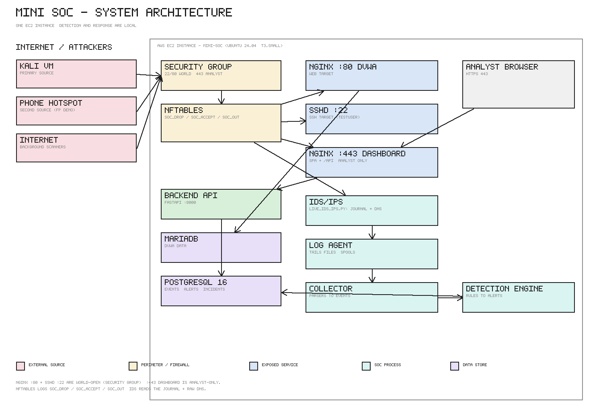

# Mini SOC Platform

A self-contained Security Operations Center (SOC) platform for detection,
alerting, investigation, and response.

- Architecture: [docs/architecture.md](docs/architecture.md)
- Contracts: [docs/contracts.md](docs/contracts.md)
- Rules: [docs/rules.md](docs/rules.md)

## Quick Start (EC2, one command)

On a fresh Ubuntu 24.04 instance:

```bash
sudo apt-get update && sudo apt-get install -y git
git clone https://github.com/Kelben-ui/mini-soc.git ~/mini-soc
sudo bash ~/mini-soc/deploy/install.sh
```

`deploy/install.sh` is idempotent and does everything: OS packages (including
**nftables**), Node 20, the checkout, service users, directories, the venv,
**PostgreSQL 16** (PGDG repo + role + database), Alembic migrations, the
frontend build, the systemd units, the nginx site + self-signed TLS certificate,
the **IDS config + allow-list + `soc-block` helper + sudoers rule**, the host
firewall (`/etc/nftables.conf`), and service start.

Then check health and open the dashboard:

```bash
systemctl status soc-backend soc-collector soc-detection soc-agent mini-soc-ids
# https://<host>/   (self-signed cert by default; set DOMAIN for a real cert)
```

Update an existing deployment:

```bash
sudo bash ~/mini-soc/deploy/update.sh   # pull, deps, migrate, build, re-render units, restart
```

## Deployment notes

- **Layout** — code `/home/ubuntu/mini-soc`, venv `/home/ubuntu/mini-soc/.venv`,
  config `<repo>/.env` (loaded by systemd `EnvironmentFile=` and
  `mini_soc_config.py`), state
  `/var/lib/mini-soc/{evidence,agent}`, logs via journald. The task plan said
  `/opt/mini-soc`; the repo was standardized on `/home/ubuntu/mini-soc` to match
  the live lab instance (see the deviations table).
- **Services** — `soc-backend` (uvicorn 127.0.0.1:8000), `soc-collector`
  (127.0.0.1:9000), `soc-detection` (`python -m detection.run`, checkpointed
  loop), `soc-agent`, `mini-soc-ids`. All run as the dedicated `mini-soc` /
  `mini-soc-ids` users with `ProtectSystem=strict` and scoped
  `ReadWritePaths`. `soc-backend` is the one exception to
  `NoNewPrivileges`: it runs the sudo-confined `soc-block` helper (task 4.7),
  and sudoers allows it nothing but that script. There is exactly **one**
  detection loop (the legacy `mini-soc-worker` unit was removed) so alerts are
  not processed twice.
- **nginx (Phase 1.2)** — the site uses the `soc` log format from
  `deploy/nginx/mini-soc.conf` (`access_log /var/log/nginx/access.log soc;`),
  which appends `body=...` so the collector can URL-decode `uri`/`query`/`body`
  twice. Without it, web payloads arrive encoded and the WEB-* rules never fire.
  The backend mounts every route under `/api/...`, so the proxy is
  `proxy_pass http://127.0.0.1:8000;` with **no** trailing slash (a trailing
  slash would strip `/api` and 404).
- **Log agent (Phase 1.8 → Phase 3 rewrite)** — reads `agents/agent.yaml`
  (from `agents/agent.example.yaml`); nothing is hard-coded in the
  agent. It tails `{nginx access.log, nginx error.log, auth.log,
  mini_soc_ids.json}` with `(path, inode)` offsets in
  `/var/lib/mini-soc/agent/state.json` (restart never loses or duplicates a
  line), handles rotation/truncation, and streams the kernel firewall log via
  `journalctl -k -f -o short-iso --cursor-file`. Lines are batched per source
  (N lines or T seconds) into one `{host, log_type, lines}` POST to the
  collector, which verifies the `X-API-Key` header. When the collector/backend
  is down batches are spooled to `/var/lib/mini-soc/agent/spool/` and replayed
  FIFO with exponential backoff. Every 30 s the agent POSTs a heartbeat to
  `/api/agents/heartbeat` including the IDS service status. `install.sh`
  installs/enables **rsyslog** (so `auth.log`/`kern.log` are produced), installs
  `agent.yaml`, and gives the agent the `adm`, `mini-soc-ids` and
  `systemd-journal` supplementary groups so it can read those files, the IDS
  output and the kernel journal - never as root.
- **IDS/IPS (Phase 4)** — `ids/live_ids_ips.py` replaces Suricata and is
  **detection-only**. Every threshold, window, allow-list and signature is read
  from `ids/ids.yaml` (nothing hard-coded). It tails the nftables
  `SOC_DROP:`/`SOC_OUT:` journal lines (+ auth log) and sniffs DNS off the wire
  with `CAP_NET_RAW`, writing one Suricata-style JSON line per alert to
  `/var/log/mini_soc_ids.json`. Blocking is a separate, human-confirmed step:
  the dashboard records a `block IP` action, the analyst confirms it, and the
  backend runs `soc-block` via sudo to add the IP to `/etc/nftables.conf`'s
  `blocklist` set (the allow-list is enforced in both the backend and the
  helper). See `docs/architecture.md` §3.2.
- **Security Group** — restrict the dashboard (443 and the 80 redirect) and SSH
  to the analyst IP; do not expose `5173`/`4173`. See Phase 0.3.
- **Local development** — copy `.env.example` to `.env`, run the backend
  (`uvicorn backend.app.main:app --reload`), and `cd frontend && npm run dev`.
  Vite proxies `/api` to `127.0.0.1:8000`, mirroring nginx in production, so no
  dashboard port is needed on EC2.

## Architecture



Editable source: [`docs/images/architecture.drawio`](docs/images/architecture.drawio);
regenerate the PNG with `python docs/images/render_architecture.py`. The
single-EC2 layout (attackers → Security Group → nftables → exposed services →
collector/detection → PostgreSQL → dashboard) is described in full in
[docs/architecture.md](docs/architecture.md).

## Deviations from Original Design

| Original | Current (EC2/systemd) | Reason |
|---|---|---|
| Docker-based deployment | Native systemd services (`deploy/systemd/` + `install.sh`/`update.sh`) | One-VM EC2 deployment; simpler ops, reproducible with systemd hardening |
| Suricata IDS | Custom lightweight IDS/IPS (`ids/`, `mini-soc-ids.service`) | Team's IDS/IPS with configurable thresholds and allow-lists; **detection-only**, with human-confirmed blocking via `soc-block` |
| Multi-VM distributed setup | Single EC2 instance | Streamlined for lab/demo environment; all services on localhost |
| Code at `/opt/mini-soc` | Code at `/home/ubuntu/mini-soc` | Matches the live lab instance; repo is the single source of truth |
| Dashboard on plain HTTP :80 | nginx TLS on :443 (self-signed by default) + :80 redirect | Protects credentials in transit; no Vite port exposed on EC2 |

**Supervisor sign-off:** the deviations above (Docker → systemd, Suricata → team
IDS, multi-VM → one EC2) were agreed with the supervisor in week 1; see
[docs/architecture.md](docs/architecture.md) §2.

## Key Paths

- Code: `/home/ubuntu/mini-soc/`
- Venv: `/home/ubuntu/mini-soc/.venv/`
- Config: `<repo>/.env` (repo root)
- Agent config: `<repo>/agents/agent.yaml`
- Evidence: `/var/lib/mini-soc/evidence/`
- Agent spool: `/var/lib/mini-soc/agent/spool/`
- Agent offsets: `/var/lib/mini-soc/agent/state.json`
- Detection checkpoint: `/var/lib/mini-soc/detection_checkpoint.json`
- Logs: journald (`journalctl -u soc-detection -f`)
- IDS output: `/var/log/mini_soc_ids.json`
- IDS config: `<repo>/ids/ids.yaml`
- Response allow-list: `<repo>/rules/allowlist.txt`
- Block helper: `/usr/local/sbin/soc-block` + `/etc/sudoers.d/mini-soc-soc-block`
- Host firewall: `/etc/nftables.conf`
- nginx site: `/etc/nginx/sites-available/mini-soc.conf`
- TLS cert/key: `/etc/ssl/mini-soc/mini-soc.{crt,key}`

## Detection

Replay test (13 rules against SQLite or the configured DB), from the repo root:

```bash
PYTHONPATH=. DATABASE_URL=sqlite:///./ci-replay.db .venv/bin/python detection/tests/replay_test.py
# expects "REPLAY TEST PASSED"
```

## Live end-to-end test (local lab)

`scripts/live-e2e.sh` brings up every component the demo path needs on this
host — PostgreSQL, MariaDB, PHP-FPM, nginx (DVWA on `:80`, dashboard on
`:443`), nftables, rsyslog and the five `soc-*`/IDS services — verifies each
one, and (with `--attack`) fires the lab attack payloads so the alerts and
events appear in the dashboard while you watch them:

```bash
sudo bash scripts/live-e2e.sh            # start + verify everything
sudo bash scripts/live-e2e.sh --attack   # ...then generate the alerts
sudo bash scripts/live-e2e.sh --status   # report only, change nothing
sudo bash scripts/live-e2e.sh --help     # all flags
```

The script is idempotent (it starts what is stopped and leaves healthy
services alone) and needs root, because it drives systemd and the `atk`
network namespace used by the network rules.

Then open DVWA at `http://127.0.0.1/dvwa/login.php` (`admin` / `password`)
and the dashboard at `https://127.0.0.1/` (`admin` / the dashboard password —
override with `SOC_USER` / `SOC_PASS`). The pages that matter are
`/alerts` and `/events`.

## Recovering the EC2 box from the repo (single source of truth)

If the lab box becomes unreachable ("kernel accepts TCP, sshd/nginx never
answer"), it is likely wedged, not compromised. Recovery by an account with EC2
access (console → Instance state → Reboot); after boot:

```bash
cd /home/ubuntu/mini-soc
git fetch origin && git reset --hard origin/main          # sync purged history
sudo bash deploy/install.sh                               # re-apply packages, venv, DB, units, nginx
systemctl status soc-backend soc-collector soc-detection soc-agent mini-soc-ids --no-pager | grep Active
```

`deploy/install.sh` removes the legacy `mini-soc-*` units and re-renders the
canonical `soc-*` units, so it also reconciles an out-of-date box. Every
referenced path and file lives in this repo at `origin/main`.
