# Mini SOC — Analyst User Guide

This guide is for **analysts using the dashboard**: triaging alerts,
investigating attack chains, running incidents and taking response actions.

- **URL:** `https://<instance>/` (analyst access is restricted to the analyst
  IP by the AWS Security Group; see [`lab-setup.md`](lab-setup.md)).
- **Sign-in:** username + password, exchanged for a JWT stored in the browser.
- **Companion reading:** the response procedures live in
  [`../playbooks/incident-response.md`](../playbooks/incident-response.md);
  the data model is in [`contracts.md`](contracts.md).

> The screenshots below were captured with the Playwright tooling in
> [`testing/screenshots/`](testing/screenshots/) against a locally-seeded demo
> database (`seed_demo.py`), so the data is synthetic. The layout and behaviour
> are identical to the deployed dashboard.

---

## 1. Signing in

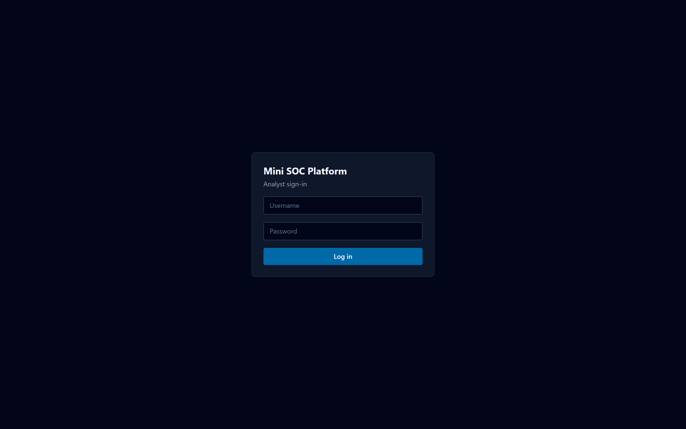

Enter your username and password and select **Log in**. Your **role**
(`analyst`, `lead` or `admin`) is read from the token and controls which
actions are offered — leads/admins can change alert status, close incidents and
export evidence; analysts can investigate and record actions.

## 2. SOC Overview

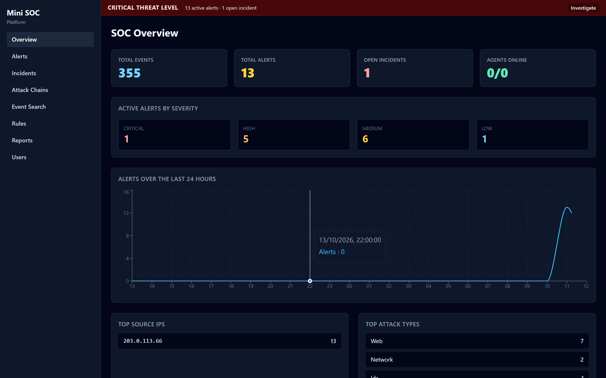

The landing page gives the current posture:

- the **threat-level banner** — the overall level and the open counts by
  severity (CRITICAL/HIGH/MEDIUM/LOW). When the level is HIGH or CRITICAL the
  banner also **names the newest active alert**, for example
  `HIGH SEVERITY — SSH BRUTE FORCE`, and links straight to it;
- recent alert activity and the top sources;
- **agent heartbeats** — any log agent that has stopped reporting shows here
  ("No agent heartbeats received" until the first beacon).

If it says "No alert data yet", the collector/detection services are not feeding
events — check the services (Section 12).

## 3. Alerts

### 3.1 The alert list

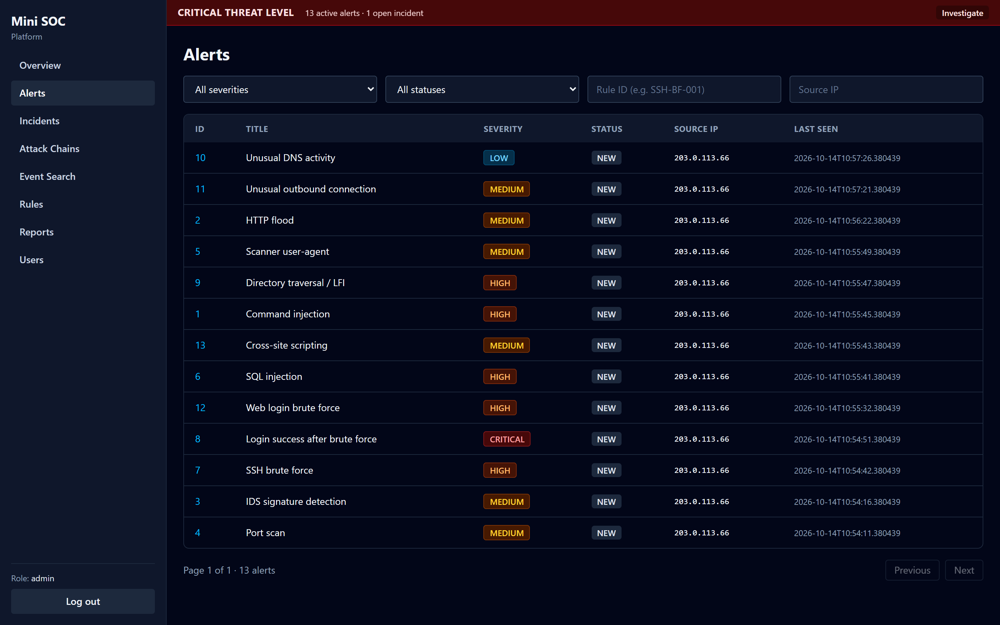

Filter by **severity**, **status**, **Rule ID** (e.g. `SSH-BF-001`), **Source
IP** and a **time range** (`From`/`To`). Each row shows the title, severity,
status, source IP and last seen time. Select a row to open the alert. The list
refreshes every few seconds, so newly detected alerts appear within 10 seconds.

### 3.2 Alert detail

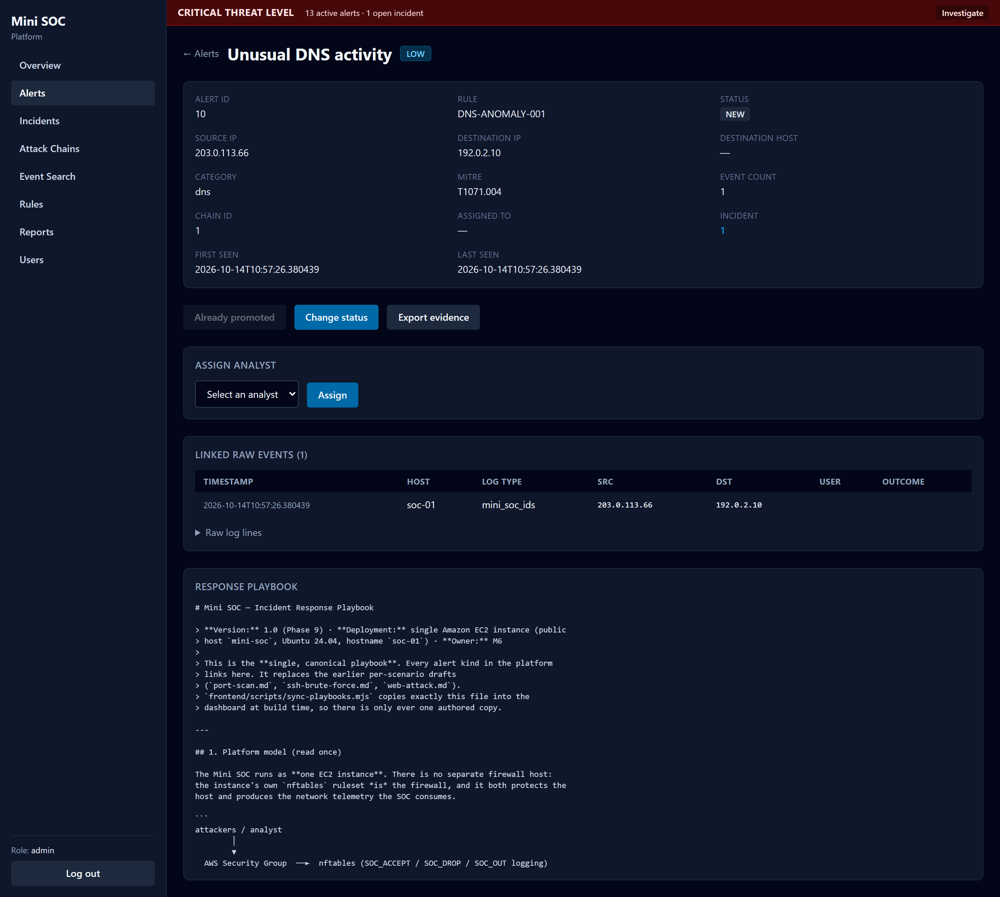

The detail view is the analyst's workspace for one alert:

- **Header fields** — rule ID, severity, status, source/destination, `count`,
  MITRE technique and category.
- **Linked raw events** — every normalized event that matched the rule
  (timestamp, host, log type, src/dst, user, outcome). This is the evidence the
  detection engine actually saw.
- **Change alert status** — move the alert through its lifecycle (see below).
- **Assign** — assign the alert to an analyst.
- **Export evidence** — download the linked raw events as an evidence file
  (recorded with a SHA-256 hash and chain of custody).
- **Promote to incident** — turn this alert (or its whole chain) into an
  incident for full investigation.
- **Response playbook** — the mapped procedure for this rule, loaded from
  [`../playbooks/incident-response.md`](../playbooks/incident-response.md).

**Alert lifecycle**

```
NEW ──► INVESTIGATING ──► CONTAINED ──► RESOLVED
  └──► FALSE POSITIVE        (also allowed from NEW / INVESTIGATING; reason required)
```

## 4. Attack chains

When alerts from one source span **two or more categories** within 30 minutes
(e.g. port scan → web attack → SSH brute force) the detection engine correlates
them into a **chain**.

- **Chains list** (`Attack Chains`) shows chain, alert count, overall severity,
  categories, source IPs and whether it is already attached to an incident.

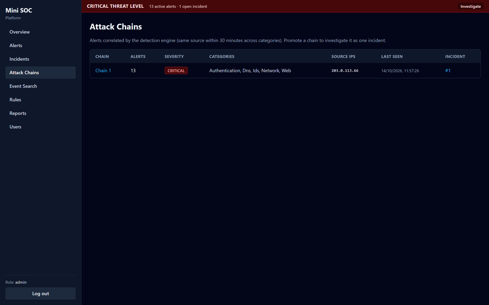

- **Chain detail** shows the alerts in time order as a kill-chain timeline and
  lets you **promote the whole chain to one incident** in a single click.

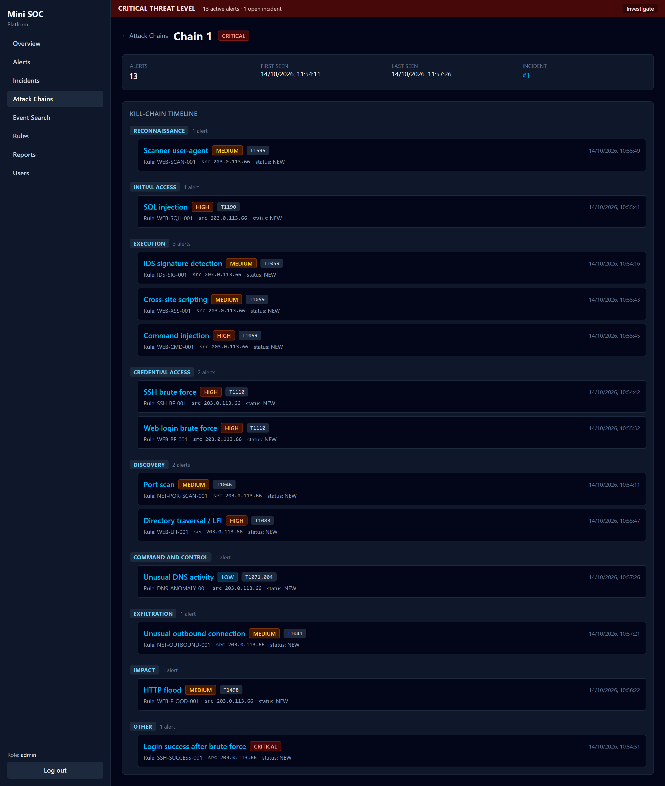

## 5. Incidents

### 4.1 Incident list

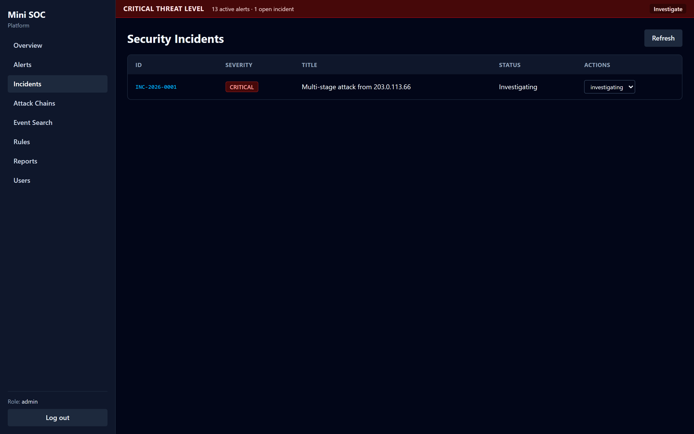

All incidents with severity, title, status and available actions.

**New incident** (lead/admin) — besides promoting an alert or chain, leads can
open the incident list, select **New incident** and fill in the title,
description, severity, category, source IPs and affected hosts manually
(`POST /api/incidents`). The dashboard jumps to the new incident once it is
created.

### 4.2 Incident detail

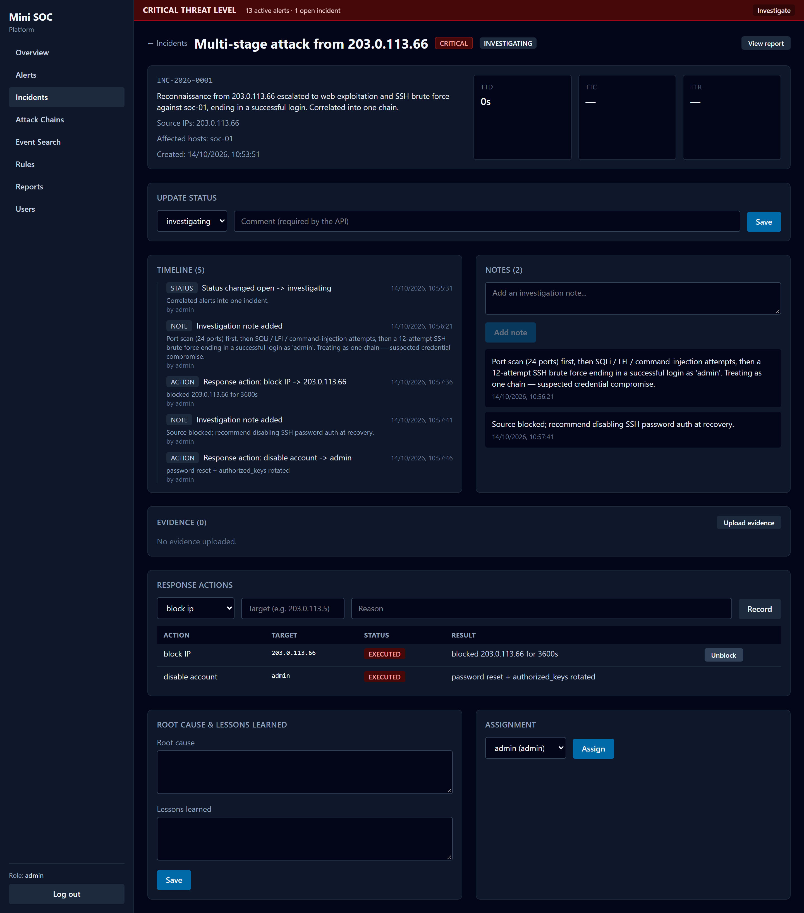

The incident is the container for the investigation:

- **Timeline** — an automatic, chronological merge of status changes, notes,
  evidence and response actions.
- **Notes** — add free-text investigation notes.
- **Evidence** — upload files (with hash + custody log) and view the custody
  trail.
- **Response actions** — record an action (target + reason), then **confirm it**
  to execute. See Section 10 for `block IP`.
- **Status** — move the incident through `open → investigating → contained →
  resolved → closed`. Closing requires a lead/admin; **root cause** and
  **lessons learned** fields feed the final report.
- **Report export** — produce the incident report (HTML/CSV) for archiving under
  `docs/reports/`.

## 5. Events

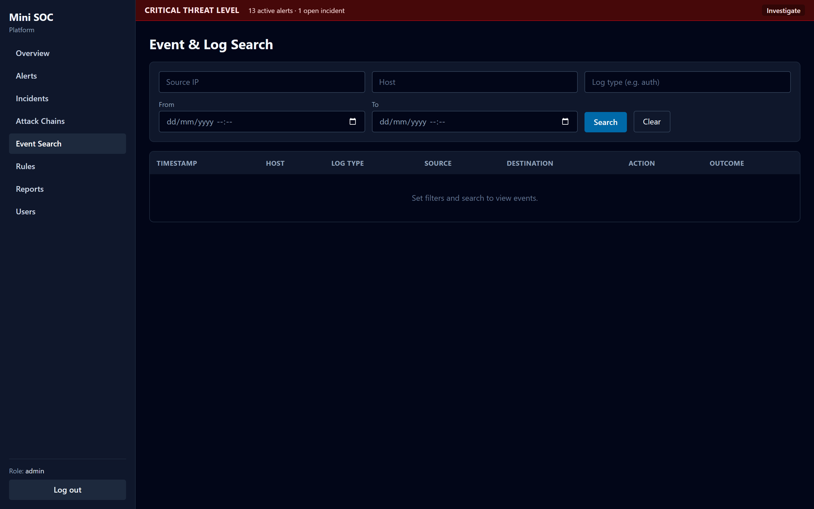

The raw normalized event stream. Filter by **source IP**, **host** and **log
type** (e.g. `auth`, `nginx_access`, `mini_soc_ids`, `firewall`). Use this to
confirm exactly what the platform received, independent of the alerting layer.

## 6. Detection rules

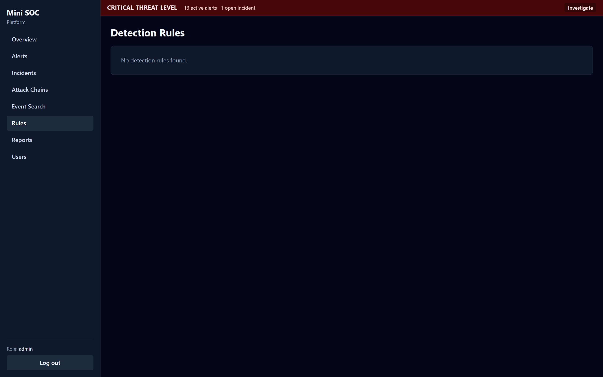

Every rule's **severity, category, MITRE technique, tactic, live alert count and
last-fired time**, plus whether it is enabled. This is the live view of
[`../rules/`](../rules/); see also [`rules.md`](rules.md).

## 7. Reports

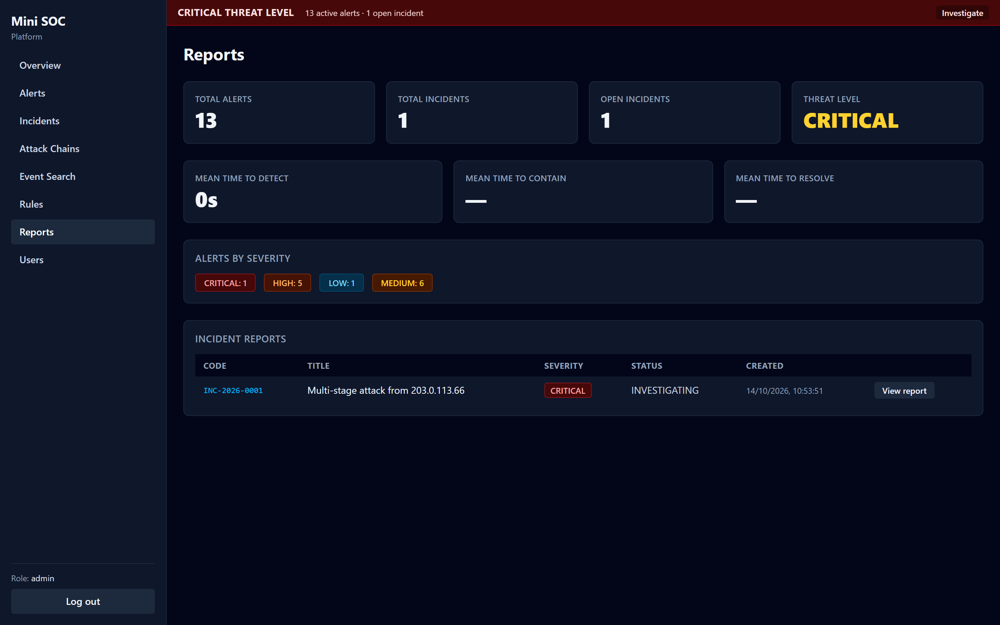

Aggregate views over alerts and incidents, with per-incident **View report**
and **Download** actions (used to produce the archived reports under
[`reports/`](reports/)). Downloading saves the report as a standalone
`INC-XXXX-report.html` file; the same actions are also available on the
incident detail page.

## 8. Users (lead/admin)

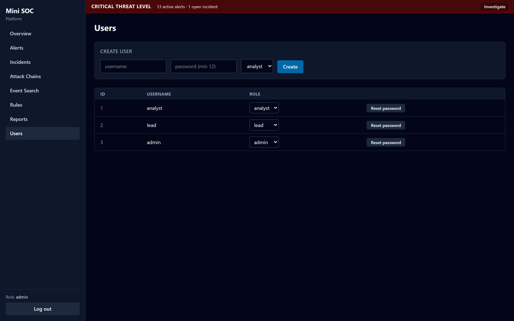

Create users, set roles and reset passwords. Passwords must meet the minimum
length. New users are created through the API/dashboard, never by editing the
database.

## 9. Response actions and containment ("Block IP")

`block IP` is the **only** response action the platform executes itself, and it
is always human-confirmed:

1. On the incident, add a response action with type **`block IP`**, the bare
   attacker **IPv4** as the target, and a reason. This *records* the decision.
2. Select **Confirm / Execute**. The backend runs `soc-block add <ip>` via sudo,
   adding the address to the nftables **`blocklist`** set with a timeout
   (default 3600 s). The action's status becomes `executed` (or `failed`).
3. **Unblock** reverses it (`soc-block del <ip>`).

Safety: the helper and the backend both refuse anything that is not a bare IPv4
address and both refuse allow-listed addresses.

Other response actions (`disable account`, `isolate host`, `reset credentials`)
are recorded on the incident timeline and carried out **manually** — the
platform does not automate them.

## 10. Roles

| Role | Can do |
|---|---|
| `analyst` | Triage alerts, investigate, add notes/evidence, record actions. |
| `lead` | Everything an analyst can, plus change alert status, close incidents and export alert evidence. |
| `admin` | Everything a lead can, plus user management. |

## 11. Troubleshooting

- **"Login failed"** — check the username/password; the backend stays the
  security boundary and rejects invalid credentials.
- **Pages empty / "No data yet"** — confirm `soc-backend`, `soc-collector`,
  `soc-detection` and `soc-agent` are running
  (`systemctl status soc-* mini-soc-ids`).
- **`401` after working earlier** — the JWT expired; sign in again.
- **No alerts from attack traffic** — check the log agent is tailing the files
  (`journalctl -u soc-agent -f`) and the collector is receiving them
  (`journalctl -u soc-collector -f`).

---

*Only monitor systems you are authorised to test. Never share secrets, keys or
unredacted sensitive logs.*
